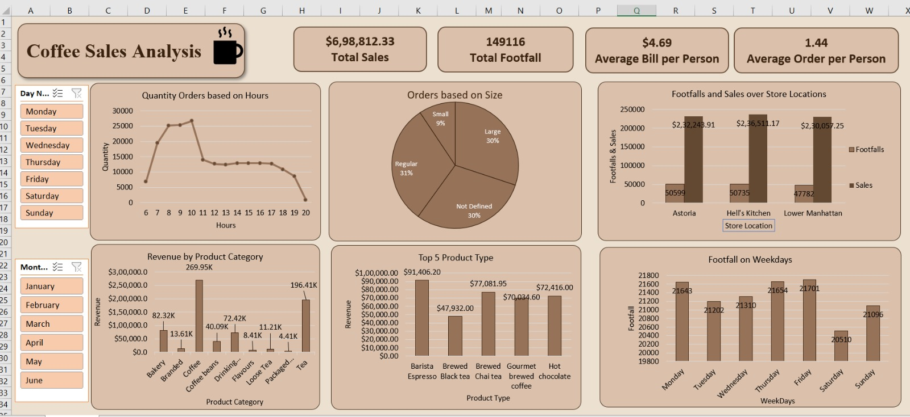

# Coffee Shop Sales Analysis (Jan to Jun 2023)

An interactive Excel dashboard on revenue, footfall, peak hours and product mix across three New York coffee stores.

**Tools:** Excel · Power Query · Data Model · Pivot Tables · Pivot Charts · Slicers

**Quick links:** [Full report (PDF)](Coffee_Shop_Sales_Report.pdf) · [Excel dashboard](Coffee_Shop_Sales_Dashboard.xlsx)

---

## Business problem

The owner of a small coffee chain wants to know when customers buy, what they buy and how the three stores (Astoria, Hell's Kitchen, Lower Manhattan) compare, so staffing, stock and promotions can be planned with evidence. The raw data is 149,116 till transactions, too granular to read. This project condenses it into a dashboard filterable by day and month.

## Key numbers

| Total sales | Footfall (transactions) | Average bill | Items per transaction |
|---|---|---|---|
| $698,812 | 149,116 | $4.69 | 1.44 |

## Key findings

- **Revenue doubled in six months** (+103.8%, $81,678 in January to $166,486 in June), driven by transaction volume; the average bill stayed flat at about $4.70.
- **A strong morning rush:** 7 to 10 AM brings 45.8% of revenue, and 8 to 10 AM sells 36.0% of all items.
- **The three stores are almost identical** in revenue (within 3%), but Lower Manhattan earns it from fewer customers who spend more ($4.81 per bill, 1.50 items).
- **Coffee and tea are 66.7% of revenue;** the top five product types earn 51.4%.
- **Day of week barely matters:** footfall varies only about 5.6% between the weakest (Saturday) and strongest (Friday) day.
- **Regular and Large sizes dominate;** Small is only 9.3% of transactions.

## Recommendations

1. Staff and stock for the 7 to 10 AM rush; consider mobile pre-ordering.
2. Create an afternoon offer (for example tea and bakery combos) for the steady but slower 11 AM to 5 PM window.
3. Run a weekend promotion, since Saturday is the weakest day.
4. Raise items per transaction by bundling, and copy Lower Manhattan's practices at the other stores.
5. Collect 12 months of data and add cost data to separate seasonality from growth and to measure profit.

## Approach

1. Imported the data with **Power Query** (query: Transactions) and loaded it into the Excel Data Model.
2. Added derived fields: Total Bill, Size, Month Name, Day Name, Hour, Month number and Day of Week.
3. Built ten pivot tables: items by hour, revenue by month, size mix, store footfall and sales, category revenue, top product types, weekday footfall and KPI measures.
4. Chose a chart for each question: line (hourly pattern), pie (size mix), columns (stores, weekdays, categories, product types).
5. Created four KPI cards and connected Day and Month slicers to all charts.

## Dataset

- Maven Analytics public "Coffee Shop Sales" sample dataset (practice data, not real client data)
- 149,116 transactions · 3 stores · 9 categories · 29 product types · 80 products · 1 Jan to 30 Jun 2023
- Checks: no missing values, unique transaction IDs, and quantity × unit price matches the sales total exactly
- The raw transactions are included in the `Transactions` sheet of the dashboard workbook

## Repository contents

| File | Description |
|---|---|
| [`Coffee_Shop_Sales_Report.pdf`](Coffee_Shop_Sales_Report.pdf) | Full report: problem, method, findings, recommendations, limitations |
| [`Coffee_Shop_Sales_Dashboard.xlsx`](Coffee_Shop_Sales_Dashboard.xlsx) | Excel workbook with the data, pivot tables and dashboard |
| [`images/dashboard.jpeg`](images/dashboard.jpeg) | Dashboard screenshot |

## How to open the dashboard

Download the `.xlsx` file (about 20 MB) and open it in desktop Excel (2016 or later). Use the Day and Month slicers on the **Dashboard** sheet to filter every chart and KPI.

## Limitations

- **Footfall is a proxy** for the number of transactions; there is no customer ID.
- Only six months of data, so seasonal effects cannot be separated from genuine growth.
- Revenue, not profit: no cost data is available.
- "Not Defined" size means the item has no size (for example scones, beans, merchandise).

---

**Author:** Abhijit Sharma
